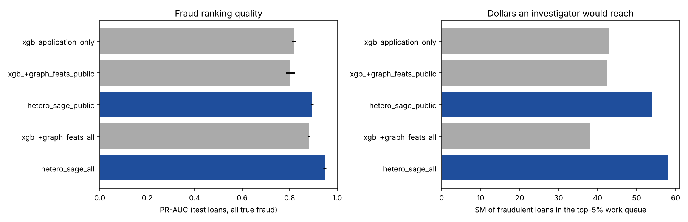

# PPP Fraud Ring Detection with Heterogeneous Graph Neural Networks

> **Mission:** Pandemic relief programs lost tens of billions of dollars to fraud, much of it through **organized
> rings**: one organizer filing dozens of applications for recruits and re-using the same addresses, phones, e-mails,
> bank accounts and devices. Looking at one loan at a time misses them. This project models loans and the identifiers
> they share as a **heterogeneous graph**, scores every loan with a GNN trained on **weak labels** (only 25% of fraud is
> known), and turns scores into **ranked investigative cases** with an evidence trail an investigator can follow.



## Results (3 seeds, test loans scored against *all* true fraud, including the 75% never labeled)

| Model | PR-AUC | ROC-AUC | Precision of top-5% queue | Fraud $ in top-5% queue |
|---|---|---|---|---|
| XGBoost, application fields only | 0.817 ± 0.008 | 0.941 | 93.9% | $43.0M |
| XGBoost + engineered graph features (public) | 0.803 ± 0.019 | 0.942 | 95.3% | $42.6M |
| XGBoost + engineered graph features (all identifiers) | 0.880 ± 0.005 | 0.965 | 99.1% | $38.1M |
| HeteroSAGE GNN, public relations only | 0.895 ± 0.005 | 0.963 | 99.9% | $53.9M |
| **HeteroSAGE GNN, all relations** | **0.948 ± 0.006** | **0.981** | **99.9%** | **$58.1M** |

**From scores to cases (Louvain communities on the shared-identifier graph, top 50 cases):**

| Case ranking | Case purity | Real rings surfaced | Share of all fraud $ |
|---|---|---|---|
| By community size (naive) | 0% | 0 | 0% |
| **By GNN risk** | **100%** | **50 / 50** | **41%** |

The naive ranking fails completely, and that is the point. The biggest clusters are **legitimate**: franchise owners,
registered-agent addresses shared by hundreds of firms, and busy tax preparers. The simulator plants these hard
negatives on purpose, so "lots of shared identifiers" alone is not evidence of fraud.

**Real-data validation (Amazon fraudulent-reviewer graph, the CARE-GNN benchmark, 3 seeds):**

| Model | ROC-AUC | PR-AUC |
|---|---|---|
| XGBoost on the 25 behavioral features | 0.977 ± 0.004 | 0.913 |
| Relation-aware HeteroSAGE (3 relation types) | 0.975 ± 0.004 | 0.899 |
| *Published CARE-GNN (Dou et al., 2020)* | *0.897* | - |

Both models beat the published GNN number. On this dataset the hand-engineered user features already carry most of
the signal, so the graph adds little. On the PPP graph, where fraudsters look normal one at a time but cluster
structurally, it adds a lot. Knowing *when* a GNN helps is the real lesson.

### Honest takeaways
* **GNNs and tree models are complementary.** The GNN dominates on ring fraud, but recalls fewer *lone* fraudsters
  (18% vs 31–40% for XGBoost in the top-5% queue), because lone actors have no network signal. Production should
  blend both scores.
* **Internal data matters.** Using only public FOIA fields (address, lender), the GNN reaches PR-AUC 0.895. Adding the
  identifiers agencies hold internally (phone, e-mail, bank account, IP, preparer) lifts it to 0.948. That is an
  argument for data-sharing agreements, not just better models.
* The top-5% queue's precision is near 100% for every graph model and recall hits its ceiling (58.6%, since the queue
  is smaller than the number of frauds). PR-AUC and dollars recovered are the discriminating metrics.

## What makes it advanced
1. **Heterogeneous graph:** 49,200 loans + 7 entity types (address, lender, phone, e-mail, bank account, IP, preparer),
   with reverse edges. Built with PyTorch Geometric `HeteroData`.
2. **Relation-specific message passing** (HeteroConv + GraphSAGE per relation, residual + LayerNorm). HGT is
   implemented and tested too (`--with-hgt`; it matched HeteroSAGE in the smaller benchmark and is slow on CPU).
3. **Positive-unlabeled learning with the label trick:** each epoch, half the training nodes reveal their "known fraud"
   label as an input feature and the loss is computed on the other half. The model learns guilt by association
   without ever seeing its own label (no leakage, unit-tested).
4. **Investigator-centric evaluation:** fixed-capacity work queues, dollars reached, ring-level recall and case purity,
   not just AUC.
5. **Explanations an investigator can use:** a per-relation attribution (remove each relation type and measure the
   score drop), gradient x input on application fields, and a concrete **evidence trail** (e.g. "shares address
   ADDR-… with 6 other loans, 2 already confirmed fraud, $849K linked").
6. **A realistic simulator** in the **exact SBA PPP FOIA column schema**, with DOJ/OIG-style typologies (loan mills,
   identity farms, payroll inflation at the $20,833 sole-proprietor maximum, fintech lender bursts) and hard negatives.

## Quick start
```bash
pip install -r requirements.txt
streamlit run app.py                      # case explorer works right after cloning (results are committed)
python scripts/run_pipeline.py            # full experiment ~30 min on 2 CPU cores (restart-safe); --quick for a smoke test
pytest -q                                 # 7 tests: schema, leakage, GNN training, ring detection, explanations
```

## Repo map
```
src/pppgraph/simulate.py  PPP loan simulator (SBA FOIA schema) with rings, lone fraud, hard negatives, weak labels
src/pppgraph/graph.py     application features, leakage-safe graph features, HeteroData builder, node splits
src/pppgraph/models.py    HeteroSAGE, HGT, PU training with the label trick
src/pppgraph/rings.py     loan-loan projection, Louvain case detection, case-level evaluation
src/pppgraph/explain.py   relation attribution, feature attribution, evidence trail
src/pppgraph/amazon.py    real-data benchmark loader (CARE-GNN Amazon graph)
```

## Using real SBA data
The public FOIA files (data.sba.gov, "PPP FOIA") share the simulator's column names, so `loan_features` and
`build_hetero_graph(df, ..., PUBLIC_RELATIONS)` run on them unchanged. Real files carry **no fraud labels**, so in
practice you would (1) seed labels from DOJ press releases or OIG referrals, (2) score with the public-relations model,
and (3) send the top cases to human review.

## Responsible use
A risk score is **a lead, not a finding**. Every case needs human investigation and due process. Shared identifiers
have innocent explanations (family businesses, shared offices, preparers), which is why the simulator includes them and
the explanations show the evidence rather than just a number. Check model scores for disparate impact by geography,
business type and demographics before any operational use.
